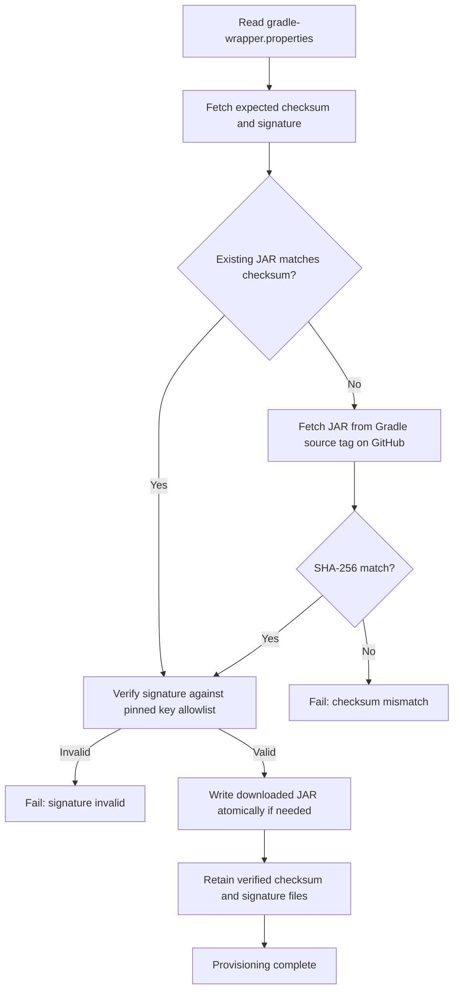

<!--
Copyright 2026 The Buildish Authors

Licensed under the Apache License, Version 2.0 (the "License");
you may not use this file except in compliance with the License.
You may obtain a copy of the License at

http://www.apache.org/licenses/LICENSE-2.0

Unless required by applicable law or agreed to in writing, software
distributed under the License is distributed on an "AS IS" BASIS,
WITHOUT WARRANTIES OR CONDITIONS OF ANY KIND, either express or implied.
See the License for the specific language governing permissions and
limitations under the License.
-->

The action provisions `gradle-wrapper.jar` files before the build runs so that Gradle can be
invoked without the jar being committed to the repository. This is the recommended Gradle project
setup for security-conscious repositories.

## Discovery

The action discovers `gradle-wrapper.properties` files under `base-directory` using:

- If `wrapper-properties-files` is set: the listed explicit file paths (relative to `base-directory`).
- If `process-all-wrapper-files: true`: a glob scan using `wrapper-properties-glob`.
- Otherwise: the single file matched by `wrapper-properties-glob` (default:
  `**/gradle/wrapper/gradle-wrapper.properties`).

An error is raised if more than one file is found when `process-all-wrapper-files` is false and
`wrapper-properties-files` is not set.

## Properties file validation

Each discovered `gradle-wrapper.properties` file is validated before any download attempt:

- The file must exist and be parseable as a Java properties file.
- The `distributionUrl` property must be present.
- The distribution URL must point to a `*.zip` file on `services.gradle.org`.
- The `distributionSha256Sum` property, if present, must be a 64-character lowercase hex string.

Validation is static — no network calls are made during this step.

## Download and verification

### SHA-256 verification

The expected SHA-256 digest is downloaded from `services.gradle.org` over HTTPS and compared
to the digest of the JAR downloaded from the matching Gradle source tag on GitHub. This guards against accidental
file corruption and mirrors the verification that `gradlew` scripts perform locally.

### PGP signature verification

A detached ASCII-armored `.asc` signature is fetched from `services.gradle.org` and verified
against a pinned allowlist of known Gradle signing keys in `src/build-tool/gradle/wrapper/signature.ts`.

Verification uses GnuPG with a fresh ephemeral home directory so no system keyring is modified.
Automatic key retrieval is disabled. Acceptance requires both a successful GnuPG exit status and
a `VALIDSIG` status record whose primary and signing fingerprints match a pinned entry. A key
that signs through a dedicated subkey must match the pinned signing subkey fingerprint; entries
without a signing subkey fingerprint permit only signatures made by the primary key.
The GnuPG binary is `gpg` on Linux and macOS. On Windows, the action resolves the first
`gpg.exe` on `PATH` to an absolute path before preparing arguments and launching it. Git for
Windows MSYS GnuPG receives `/d/...` paths; native Windows GnuPG receives Windows paths.
Set `BUILDISH_MAMMOTH_CACHE_GRADLE_GPG_COMMAND` to an absolute executable path to select a specific
installation. This override is evaluated only on Windows.

### Atomic write

The JAR is written to a temporary file in the same directory as the target path and then renamed
atomically. This ensures that a partially written JAR is never visible to the Gradle invocation.

### Key allowlist design

The key allowlist in `src/build-tool/gradle/wrapper/signature.ts` is an explicit list of Gradle's published
signing keys. Old and new keys may overlap during a key rotation period. Once a key is no longer
used to sign any wrapper version you support, remove it from the allowlist.

The allowlist is validated lazily before the first detached-signature verification and cached for
the process. Each entry must contain exactly one primary key matching its expected fingerprint
and, when configured, the expected signing subkey. Invalid key material fails verification.

## Re-entrant provisioning

If a `gradle-wrapper.jar` already exists at the target path, the action skips the JAR download only
when its bytes match the expected checksum. Matching existing bytes still undergo detached-signature
verification. A JAR with a different checksum is replaced only after the downloaded bytes pass both
checksum and signature verification.

After successful verification, the action writes these files beside each wrapper properties file:

- `gradle-wrapper-<distributionVersion>.jar.sha256`
- `gradle-wrapper-<distributionVersion>.jar.asc`

The checksum file contains the verified lowercase digest followed by a newline. The `.jar.sha256`
filename lets custom launchers that expect this checksum retain the provisioned JAR. The version
spelling comes from `distributionUrl`: for example, `8.14` stays `8.14`, even though the JAR is fetched
from source tag `v8.14.0`. The checksum sidecar supports launcher interoperability; it is not an
independent trust root.

Re-entrant provisioning recreates missing metadata and repairs stale metadata after verification,
including when the JAR download is skipped. Each file is written atomically, but the JAR and metadata
files are not published as one atomic transaction.
