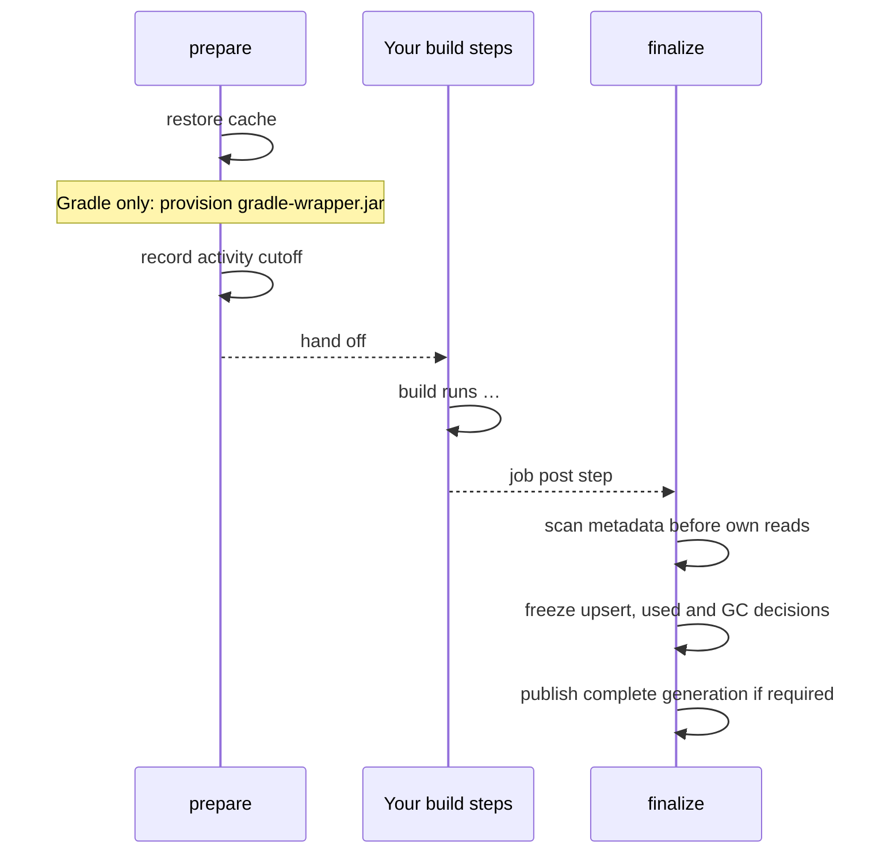

<!--
Copyright 2026 The Buildish Authors

Licensed under the Apache License, Version 2.0 (the "License");
you may not use this file except in compliance with the License.
You may obtain a copy of the License at

http://www.apache.org/licenses/LICENSE-2.0

Unless required by applicable law or agreed to in writing, software
distributed under the License is distributed on an "AS IS" BASIS,
WITHOUT WARRANTIES OR CONDITIONS OF ANY KIND, either express or implied.
See the License for the specific language governing permissions and
limitations under the License.
-->

Gradle dependency metadata is cached by default in `dependency-metadata`. A standalone job owns
its complete snapshot automatically. On prepare, preexisting managed metadata is replaced; cache
misses start that partition empty, and displaced files produce a warning and GitHub summary.
For distributed jobs, [select a metadata writer](../distributed-jobs/#gradle-metadata-writer) using the
same partition configuration in every job. Without one, Mammoth retains the previous snapshot and
warns that local metadata updates will not be published.

## What this action does

This action speeds up JVM builds on CI by caching the build tool's local artifact store between
runs. On each run it:

1. **Restores** the cache before the build so the build tool finds its dependencies already in
   place.
2. **Publishes** a new complete immutable cache generation after a material change. Unchanged hits
   do not create duplicate entries.

Two job modes are available for both build tools:

- **[Single-job](../single-job/)** — one build job per workflow run. The action wraps that job and
  handles everything automatically.
- **[Distributed multi-job](../distributed-jobs/)** — multiple parallel build jobs. Each job
  uploads only the delta it produced; a dedicated aggregator job merges all deltas into the next
  cache entry so no job's work is lost.

### Gradle

For Gradle the action caches `GRADLE_USER_HOME` and additionally:

- **Provisions** any missing `gradle-wrapper.jar` files, verifying each one with a SHA-256
  checksum and a PGP signature before writing it to disk. See
  [Security](../security/#gradle-wrapper-verification) for details.

### Maven

For Maven the action caches the Maven user home (`~/.m2` by default, or the path set by
`maven-user-home`), including the local repository under `repository/` and Maven Wrapper downloads
under `wrapper/dists/`. No wrapper provisioning is performed — Maven's own bootstrap is handled by
the runner environment or `actions/setup-java`.

Build-output caching requires a separately configured Maven extension. See
[goal-level incremental caching](../maven-caching-patterns/#goal-level-incremental-caching)
for how it relates to Mammoth's repository caching.

## Workflow shape

For an existing workflow, first use [Adoption and Migration](../adoption/) to choose cache owners,
preserve write restrictions and define a small pilot.

The examples below document the action contract. Pin an exact published release or candidate
ref containing the generated `dist/` bundles, and place the action step _before_ your build
invocation. Ordinary source branches such as `main` omit those bundles and cannot be used as
installable action refs. Available candidates and final releases are listed on
[GitHub Releases](https://github.com/buildish-tooling/buildish-mammoth-cache/releases).

> [!WARNING]
> Do not set `cache: gradle` or `cache: maven` on `actions/setup-java` when using this action.
> Both would restore and save the same directory through independent cache lifecycles. The competing
> snapshots waste storage and can undo the managed state assembled by distributed jobs. Use
> `actions/setup-java` for JDK installation only, as the examples above show.

Cache and same-run delta artifact operations use job-scoped Actions runtime credentials, so they do
not require `actions: write`. The examples grant only `contents: read` for checkout. See
[Security](../security/) for the full permissions boundary.

The action defaults to **read-only** on `pull_request` and `pull_request_target` events, so
cache writes from untrusted forks are automatically suppressed. Repository config can make this
policy stricter but cannot lower the pull-request floor; only a direct workflow input can do that.
Distributed read-only workers upload nothing, and read-only aggregators perform no artifact
exchange.

### Gradle

```yaml
jobs:
  build:
    runs-on: ubuntu-latest
    permissions:
      contents: read
    steps:
      - uses: actions/checkout@93cb6efe18208431cddfb8368fd83d5badbf9bfd
      - uses: actions/setup-java@be666c2fcd27ec809703dec50e508c2fdc7f6654
        with:
          distribution: temurin
          java-version: '21'
      - uses: buildish-tooling/buildish-mammoth-cache/actions/github/gradle@<materialized-ref>
      - run: ./gradlew build
```

### Maven

```yaml
jobs:
  build:
    runs-on: ubuntu-latest
    permissions:
      contents: read
    steps:
      - uses: actions/checkout@93cb6efe18208431cddfb8368fd83d5badbf9bfd
      - uses: actions/setup-java@be666c2fcd27ec809703dec50e508c2fdc7f6654
        with:
          distribution: temurin
          java-version: '21'
      - uses: buildish-tooling/buildish-mammoth-cache/actions/github/maven@<materialized-ref>
      - run: mvn verify
```

## How it works

The action runs twice per job: a **prepare** step before the build and a **finalize** step after.
Prepare records a cutoff after restore; finalize observes metadata after the build. Workers
exchange assumed changed files and usage paths; eligible writers save complete generations when
required. Filesystem and clock behavior make activity detection best-effort.



For distributed multi-job builds, worker jobs upload their delta as a workflow artifact instead of
saving the cache directly. An aggregator job then merges all worker deltas into a single cache
entry. See [Distributed multi-job](../distributed-jobs/) for details.
