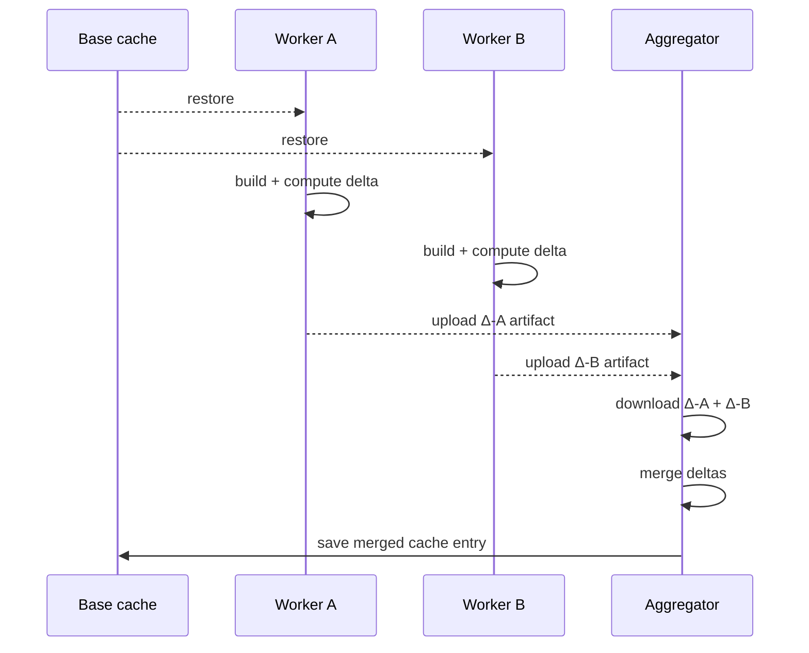

<!--
Copyright 2026 The Buildish Authors

Licensed under the Apache License, Version 2.0 (the "License");
you may not use this file except in compliance with the License.
You may obtain a copy of the License at

http://www.apache.org/licenses/LICENSE-2.0

Unless required by applicable law or agreed to in writing, software
distributed under the License is distributed on an "AS IS" BASIS,
WITHOUT WARRANTIES OR CONDITIONS OF ANY KIND, either express or implied.
See the License for the specific language governing permissions and
limitations under the License.
-->

## Why distributed mode exists

When multiple build jobs run in parallel and each publishes an independent full-cache generation,
those generations diverge. Restoring only the newest one loses dependency downloads and other cache
changes that exist solely in the other workers' generations.

Distributed mode solves this with **delta exchange**:

- Each **worker job** uploads assumed changed files and path-only activity observations as a
  workflow artifact. It does not write the base cache directly.
- An **aggregator job**, which waits for all workers to complete, downloads every delta, merges
  them, and saves the merged result as the new base cache entry.

Observed parallel changes are combined. On the next run, all workers start from a cache that
reflects the combined output of every job from the previous run.



## How delta exchange works

1. Worker prepare restores the base and records a cutoff after its own reads/writes.
2. The build runs normally.
3. Worker finalize scans metadata before its own content reads and uploads selected upserts/usage.
   Empty observation sets still produce completion envelopes. Workers never save the base.
4. Aggregate prepare validates/applies selected envelopes and retains upstream activity before C.
   Used-only paths do not recreate absent files.
5. Aggregate finalize performs eligible GC and requires successful publication for upserts, GC
   removal or a nonempty miss. Usage alone does not require a generation. Fresh replay may still
   upload identical material again. No deletion tombstones are exchanged.

On pull-request events, read-only mode performs no exchange: workers upload nothing, and an
aggregator returns `skipped-read-only` without listing, downloading, validating, applying, or
deleting artifacts. This makes a static topology safe, but a workflow should avoid allocating the
aggregator runner when it can express the writable-event condition directly.

## Gradle workflow example

```yaml
jobs:
  worker-a:
    runs-on: ubuntu-latest
    permissions:
      contents: read
    steps:
      - uses: actions/checkout@93cb6efe18208431cddfb8368fd83d5badbf9bfd
      - uses: actions/setup-java@be666c2fcd27ec809703dec50e508c2fdc7f6654
        with:
          distribution: temurin
          java-version: '21'
      - uses: buildish-tooling/buildish-mammoth-cache/actions/github/gradle@<commit-sha>
        with:
          job-mode: distributed-worker
      - run: ./gradlew :module-a:build

  worker-b:
    runs-on: ubuntu-latest
    permissions:
      contents: read
    steps:
      - uses: actions/checkout@93cb6efe18208431cddfb8368fd83d5badbf9bfd
      - uses: actions/setup-java@be666c2fcd27ec809703dec50e508c2fdc7f6654
        with:
          distribution: temurin
          java-version: '21'
      - uses: buildish-tooling/buildish-mammoth-cache/actions/github/gradle@<commit-sha>
        with:
          job-mode: distributed-worker
      - run: ./gradlew :module-b:build

  aggregator:
    needs: [worker-a, worker-b]
    if: ${{ always() && github.event_name != 'pull_request' && github.event_name != 'pull_request_target' }}
    runs-on: ubuntu-latest
    permissions:
      contents: read
    steps:
      - uses: actions/checkout@93cb6efe18208431cddfb8368fd83d5badbf9bfd
      - uses: actions/setup-java@be666c2fcd27ec809703dec50e508c2fdc7f6654
        with:
          distribution: temurin
          java-version: '21'
      - uses: buildish-tooling/buildish-mammoth-cache/actions/github/gradle@<commit-sha>
        with:
          job-mode: distributed-aggregator
          dependent-jobs: worker-a, worker-b
```

## Maven workflow example

```yaml
jobs:
  worker-a:
    runs-on: ubuntu-latest
    permissions:
      contents: read
    steps:
      - uses: actions/checkout@93cb6efe18208431cddfb8368fd83d5badbf9bfd
      - uses: actions/setup-java@be666c2fcd27ec809703dec50e508c2fdc7f6654
        with:
          distribution: temurin
          java-version: '21'
      - uses: buildish-tooling/buildish-mammoth-cache/actions/github/maven@<commit-sha>
        with:
          job-mode: distributed-worker
      - run: mvn -pl module-a verify

  worker-b:
    runs-on: ubuntu-latest
    permissions:
      contents: read
    steps:
      - uses: actions/checkout@93cb6efe18208431cddfb8368fd83d5badbf9bfd
      - uses: actions/setup-java@be666c2fcd27ec809703dec50e508c2fdc7f6654
        with:
          distribution: temurin
          java-version: '21'
      - uses: buildish-tooling/buildish-mammoth-cache/actions/github/maven@<commit-sha>
        with:
          job-mode: distributed-worker
      - run: mvn -pl module-b verify

  aggregator:
    needs: [worker-a, worker-b]
    if: ${{ always() && github.event_name != 'pull_request' && github.event_name != 'pull_request_target' }}
    runs-on: ubuntu-latest
    permissions:
      contents: read
    steps:
      - uses: actions/checkout@93cb6efe18208431cddfb8368fd83d5badbf9bfd
      - uses: actions/setup-java@be666c2fcd27ec809703dec50e508c2fdc7f6654
        with:
          distribution: temurin
          java-version: '21'
      - uses: buildish-tooling/buildish-mammoth-cache/actions/github/maven@<commit-sha>
        with:
          job-mode: distributed-aggregator
          dependent-jobs: worker-a, worker-b
```

## Requirements and constraints

**Job names must be unique within the workflow run.** Delta artifacts are identified by job name.
Two worker jobs with the same name would produce the same artifact name and the aggregator would
only see one of them.

**The aggregator must declare `needs` for every worker.** This ensures all deltas are uploaded
before the aggregator starts and consumes them during prepare.

**A writable aggregator should use `if: always()` together with its trusted-event condition.** The
aggregator must run after a failed worker so it can report the missing envelope instead of being
silently skipped. Pull-request aggregators may be omitted entirely; if they do run, their read-only
result is the explicit no-op described above.

**Workers do not need the aggregator in their `needs`.** Workers are independent of each other;
only the aggregator depends on all workers.

**Re-runs reuse retained worker envelopes.** For each worker, the aggregator selects the highest available producer
attempt that is not newer than its own attempt. A full rerun uses every new worker envelope; a
failed-job rerun safely mixes rerun workers with retained earlier attempts; and an aggregator-only
rerun reuses retained worker envelopes. Selection never crosses workflow run IDs.

Mammoth retains worker envelopes after failed and successful aggregation, including when no new
cache generation is needed. Workers request seven days of artifact retention. Retry availability
ends when the backend expires or removes the artifacts, the workflow run is deleted, or a user or
administrator removes them; availability for a full seven days is not guaranteed. Retention uses
temporary artifact storage until removal. Local staging and download directories are still cleaned
up after use.

If a required envelope is missing or expired, aggregation fails with the worker name even if a base
cache was restored. Rerun the affected worker and then the aggregator within the same workflow run.
A fresh retry can rewrite matching worker upserts and publish another complete generation, even
when resulting bytes match an earlier successful aggregate. Existing targets are not hashed
to prove a no-op; remote worker envelopes remain available for recovery.

**A successful writable worker always uploads one envelope.** This includes workers that changed no
managed cache files: their explicit empty envelope is proof of participation and is distinct from a
missing or failed worker.

## Using a config file

Repeat inputs can be moved to a shared config file. The file format is identical for both build
tools — use the config keys matching your tool's action.

```yaml
# .github/buildish-mammoth-gradle.yml  (Gradle example)
cache-key-prefix: my-project-gradle-
wrapper-properties-files: gradle/wrapper/gradle-wrapper.properties
```

```yaml
# Each worker job
- uses: buildish-tooling/buildish-mammoth-cache/actions/github/gradle@<commit-sha>
  with:
    job-mode: distributed-worker
    config-file: .github/buildish-mammoth-gradle.yml

# Aggregator job
- uses: buildish-tooling/buildish-mammoth-cache/actions/github/gradle@<commit-sha>
  with:
    job-mode: distributed-aggregator
    dependent-jobs: worker-a, worker-b
    config-file: .github/buildish-mammoth-gradle.yml
```
