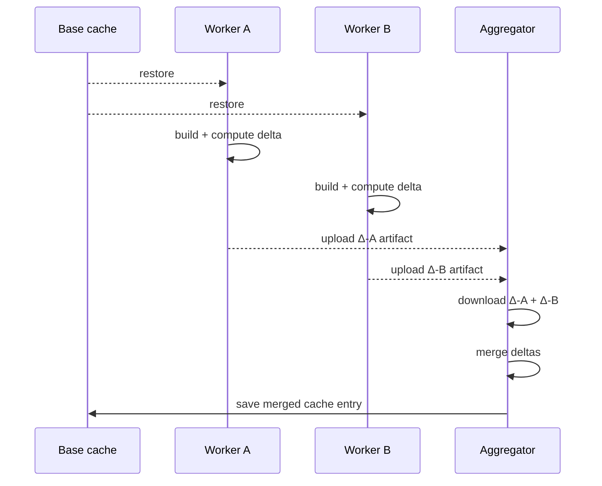

<!--
Copyright 2026 The Buildish Authors

Licensed under the Apache License, Version 2.0 (the "License");
you may not use this file except in compliance with the License.
You may obtain a copy of the License at

http://www.apache.org/licenses/LICENSE-2.0

Unless required by applicable law or agreed to in writing, software
distributed under the License is distributed on an "AS IS" BASIS,
WITHOUT WARRANTIES OR CONDITIONS OF ANY KIND, either express or implied.
See the License for the specific language governing permissions and
limitations under the License.
-->

## Why distributed mode exists

When multiple build jobs run in parallel and each publishes an independent full-cache generation,
those generations diverge. Restoring only the newest one loses dependency downloads and other cache
changes that exist solely in the other workers' generations.

Distributed mode solves this with **delta exchange**:

- Each **worker job** uploads assumed changed files and path-only activity observations for aggregate
  partitions, plus complete snapshots for any single-writer partitions it owns. It does not write
  the base cache directly.
- An **aggregator job**, which waits for all workers to complete, downloads every delta, merges
  them, and saves the merged result as the new base cache entry.

Observed parallel changes in aggregate partitions are combined. Single-writer partitions use
only their designated writer's complete snapshot. On the next run, all workers start from a cache that
reflects the combined output of every job from the previous run.



## How delta exchange works

1. Worker prepare restores the base and records a cutoff after its own reads/writes.
2. The build runs normally.
3. Worker finalize scans metadata before its own content reads and uploads selected upserts/usage.
   Empty observation sets still produce completion envelopes. Workers never save the base.
4. Aggregate prepare validates/applies selected envelopes and retains upstream activity before C.
   Used-only paths do not recreate absent files.
5. Aggregate finalize performs eligible GC and requires successful publication for upserts, GC
   removal or a nonempty miss. Usage alone does not require a generation. Fresh replay may still
   upload identical material again. Aggregate partitions exchange no deletion tombstones. A
   single-writer snapshot replaces its complete configured membership, including removals, and
   metadata-only changes independently require publication.

On pull-request events, read-only mode performs no exchange: workers upload nothing, and an
aggregator returns `skipped-read-only` without listing, downloading, validating, applying, or
deleting artifacts. This makes a static topology safe, but a workflow should avoid allocating the
aggregator runner when it can express the writable-event condition directly.

## Gradle metadata writer

Gradle's `dependency-metadata` partition is enabled by default and uses `single-writer`
publication. Choose one existing worker as its metadata writer and pass the **same** partition
configuration to every worker and the aggregator. The writer is identified by Mammoth's producer
job identity, which defaults to the workflow job ID. If you set `github-job-name` for a matrix or
reusable workflow, use that exact identity for `writer` and `dependent-jobs` too. Matrix producers
must have distinct identities; a writer designates one producer, not the entire matrix.

Only that job's complete configured metadata set replaces the previous snapshot. Other workers'
artifact downloads still aggregate normally; their local dependency-metadata updates do not.
Choose a writer whose build resolves the dependencies you want covered. Metadata learned only by
other jobs may need resolution again later. A validated snapshot qualifies even if its build failed.

An aggregator owns the complete snapshot when no `writer` is configured or when it names itself.
In either case its own post-build metadata wins. If another job is named, that job's snapshot or
the prepared fallback remains authoritative despite the aggregator's local changes.

### Complete workflow with an existing worker as writer

The following workflow is also available in the repository as
`examples/gradle-distributed.yml`. Adapt the module tasks and replace `<commit-sha>` with the
Mammoth version you deploy.

```yaml
name: Gradle distributed cache
on: [push, pull_request, workflow_dispatch]

permissions:
  contents: read

env:
  MAMMOTH_CACHE_PARTITIONS: '[{"id":"dependency-metadata","writer":"worker-a"}]'

jobs:
  worker-a:
    runs-on: ubuntu-latest
    steps:
      - uses: actions/checkout@93cb6efe18208431cddfb8368fd83d5badbf9bfd
      - uses: actions/setup-java@be666c2fcd27ec809703dec50e508c2fdc7f6654
        with:
          distribution: temurin
          java-version: '21'
      - uses: buildish-tooling/buildish-mammoth-cache/actions/github/gradle@<commit-sha>
        with:
          job-mode: distributed-worker
          cache-partitions: ${{ env.MAMMOTH_CACHE_PARTITIONS }}
      - run: ./gradlew :module-a:build

  worker-b:
    runs-on: ubuntu-latest
    steps:
      - uses: actions/checkout@93cb6efe18208431cddfb8368fd83d5badbf9bfd
      - uses: actions/setup-java@be666c2fcd27ec809703dec50e508c2fdc7f6654
        with:
          distribution: temurin
          java-version: '21'
      - uses: buildish-tooling/buildish-mammoth-cache/actions/github/gradle@<commit-sha>
        with:
          job-mode: distributed-worker
          cache-partitions: ${{ env.MAMMOTH_CACHE_PARTITIONS }}
      - run: ./gradlew :module-b:build

  aggregator:
    needs: [worker-a, worker-b]
    if: ${{ always() && github.event_name != 'pull_request' && github.event_name != 'pull_request_target' }}
    runs-on: ubuntu-latest
    steps:
      - uses: actions/checkout@93cb6efe18208431cddfb8368fd83d5badbf9bfd
      - uses: actions/setup-java@be666c2fcd27ec809703dec50e508c2fdc7f6654
        with:
          distribution: temurin
          java-version: '21'
      - uses: buildish-tooling/buildish-mammoth-cache/actions/github/gradle@<commit-sha>
        with:
          job-mode: distributed-aggregator
          cache-partitions: ${{ env.MAMMOTH_CACHE_PARTITIONS }}
          dependent-jobs: worker-a, worker-b
```

This chooses `worker-a` without an extra job. Because both workers are also listed in
`dependent-jobs`, both ordinary completion envelopes remain required. `needs` ensures their
post actions finish before aggregate prepare performs artifact discovery.

### Optional metadata writer that can be skipped

A writer reference is optional snapshot discovery. To permit a metadata-only job to be skipped,
include it in `needs` for ordering, but omit it from `dependent-jobs`. The ordinary build worker
remains required. This example is available as `examples/gradle-optional-metadata-writer.yml`.
It runs a second build to populate the writer's metadata; use an existing suitable worker when
that extra work is unnecessary.

```yaml
name: Gradle cache with optional metadata writer
on:
  push:
  pull_request:
  workflow_dispatch:
    inputs:
      run_metadata:
        description: Run the metadata writer
        type: boolean
        default: true

permissions:
  contents: read

env:
  MAMMOTH_CACHE_PARTITIONS: '[{"id":"dependency-metadata","writer":"metadata"}]'

jobs:
  build:
    runs-on: ubuntu-latest
    steps:
      - uses: actions/checkout@93cb6efe18208431cddfb8368fd83d5badbf9bfd
      - uses: actions/setup-java@be666c2fcd27ec809703dec50e508c2fdc7f6654
        with:
          distribution: temurin
          java-version: '21'
      - uses: buildish-tooling/buildish-mammoth-cache/actions/github/gradle@<commit-sha>
        with:
          job-mode: distributed-worker
          cache-partitions: ${{ env.MAMMOTH_CACHE_PARTITIONS }}
      - run: ./gradlew build

  metadata:
    if: ${{ github.event_name != 'pull_request' && github.event_name != 'pull_request_target' && (github.event_name != 'workflow_dispatch' || inputs.run_metadata) }}
    runs-on: ubuntu-latest
    steps:
      - uses: actions/checkout@93cb6efe18208431cddfb8368fd83d5badbf9bfd
      - uses: actions/setup-java@be666c2fcd27ec809703dec50e508c2fdc7f6654
        with:
          distribution: temurin
          java-version: '21'
      - uses: buildish-tooling/buildish-mammoth-cache/actions/github/gradle@<commit-sha>
        with:
          job-mode: distributed-worker
          cache-partitions: ${{ env.MAMMOTH_CACHE_PARTITIONS }}
      - run: ./gradlew build

  optional-aggregator:
    needs: [build, metadata]
    if: ${{ always() && github.event_name != 'pull_request' && github.event_name != 'pull_request_target' }}
    runs-on: ubuntu-latest
    steps:
      - uses: actions/checkout@93cb6efe18208431cddfb8368fd83d5badbf9bfd
      - uses: actions/setup-java@be666c2fcd27ec809703dec50e508c2fdc7f6654
        with:
          distribution: temurin
          java-version: '21'
      - uses: buildish-tooling/buildish-mammoth-cache/actions/github/gradle@<commit-sha>
        with:
          job-mode: distributed-aggregator
          cache-partitions: ${{ env.MAMMOTH_CACHE_PARTITIONS }}
          dependent-jobs: build
```

On a manual run with `run_metadata: false`, the aggregator still runs and imports the required
`build` envelope. The missing metadata contribution leaves the previous snapshot unchanged and
produces a warning and GitHub summary entry. If no previous snapshot exists, metadata remains
absent. If the metadata job does run, only its metadata snapshot is imported; its ordinary artifact
updates are ignored because it is not in `dependent-jobs`.

If that job is also required for ordinary cached files, list it in `dependent-jobs`; skipping it
will then fail aggregation as a missing required worker. A malformed, ambiguous, corrupt, or
incompatible writer contribution fails validation rather than silently falling back. An explicit
empty snapshot is valid and clears the configured partition; it differs from an absent snapshot.

### Defaults and operational behavior

With no writer configured, distributed mode preserves the previous metadata, warns, and explains
how to select a writer in the GitHub summary. Configure the same writer everywhere: writer and
publication policy affect the cache family, so changing them starts a cold cache. Existing cache
families are cold misses after this protocol update too.

Before restore, Mammoth removes preexisting **managed** snapshot files, warning and recording the
replacement in the summary. A miss starts those partitions empty, including on self-hosted runners
and with ordinary cleanup disabled. User-excluded files survive. Explicit include/exclude overrides
are allowed; their effect on Gradle's internal metadata relationships is the user's responsibility.

Mammoth retains authoritative snapshot bytes separately from each job's mutable local Gradle data.
Snapshot staging copies/hashes the full configured file set in standalone mode as well; distributed
writers also upload complete payloads. Snapshot partitions skip Mammoth's per-file GC. Artifact GC
continues independently, so metadata can refer to evicted artifacts and offline completeness is
not guaranteed. See [Cache partitions](../cache-partitions/#publication-policies) and
[Gradle cache internals](../../architecture/gradle-cache-internals/).

## Maven workflow example

```yaml
jobs:
  worker-a:
    runs-on: ubuntu-latest
    permissions:
      contents: read
    steps:
      - uses: actions/checkout@93cb6efe18208431cddfb8368fd83d5badbf9bfd
      - uses: actions/setup-java@be666c2fcd27ec809703dec50e508c2fdc7f6654
        with:
          distribution: temurin
          java-version: '21'
      - uses: buildish-tooling/buildish-mammoth-cache/actions/github/maven@<commit-sha>
        with:
          job-mode: distributed-worker
      - run: mvn -pl module-a verify

  worker-b:
    runs-on: ubuntu-latest
    permissions:
      contents: read
    steps:
      - uses: actions/checkout@93cb6efe18208431cddfb8368fd83d5badbf9bfd
      - uses: actions/setup-java@be666c2fcd27ec809703dec50e508c2fdc7f6654
        with:
          distribution: temurin
          java-version: '21'
      - uses: buildish-tooling/buildish-mammoth-cache/actions/github/maven@<commit-sha>
        with:
          job-mode: distributed-worker
      - run: mvn -pl module-b verify

  aggregator:
    needs: [worker-a, worker-b]
    if: ${{ always() && github.event_name != 'pull_request' && github.event_name != 'pull_request_target' }}
    runs-on: ubuntu-latest
    permissions:
      contents: read
    steps:
      - uses: actions/checkout@93cb6efe18208431cddfb8368fd83d5badbf9bfd
      - uses: actions/setup-java@be666c2fcd27ec809703dec50e508c2fdc7f6654
        with:
          distribution: temurin
          java-version: '21'
      - uses: buildish-tooling/buildish-mammoth-cache/actions/github/maven@<commit-sha>
        with:
          job-mode: distributed-aggregator
          dependent-jobs: worker-a, worker-b
```

## Requirements and constraints

**Job names must be unique within the workflow run.** Delta artifacts are identified by job name.
Two worker jobs with the same name would produce the same artifact name and the aggregator would
only see one of them.

**The aggregator must declare `needs` for every consumed worker and optional metadata writer.** This ensures all deltas are uploaded
before the aggregator starts and consumes them during prepare.

**Choose whether aggregation should run after worker failures.** Use `if: always()` together with
trusted event/ref conditions when you want to consume valid envelopes from failed builds or report
missing envelopes. A skipped worker or a missing post upload, including after cancellation, leaves
a required envelope absent. Pull-request aggregators may be omitted entirely; if they do run, their
read-only result is the explicit no-op described above.

**Workers do not need the aggregator in their `needs`.** Workers are independent of each other;
only the aggregator depends on all workers.

**Re-runs reuse retained worker envelopes.** For each worker, the aggregator selects the highest available producer
attempt that is not newer than its own attempt. A full rerun uses every new worker envelope; a
failed-job rerun safely mixes rerun workers with retained earlier attempts; and an aggregator-only
rerun reuses retained worker envelopes. Selection never crosses workflow run IDs.

Mammoth retains worker envelopes after failed and successful aggregation, including when no new
cache generation is needed. Workers request seven days of artifact retention by default. Set
`worker-artifact-retention-days` on either action to request a shorter period, for example one day
to reduce artifact residence:

```yaml
- uses: buildish-tooling/buildish-mammoth-cache/actions/github/gradle@<commit-sha>
  with:
    job-mode: distributed-worker
    worker-artifact-retention-days: 1
```

Shorter retention narrows the selective or aggregator-only retry window and can require rerunning
expired workers. Base cache expiry and timestamp GC are independent. Retry availability
ends when the backend expires or removes the artifacts, the workflow run is deleted, or a user or
administrator removes them. Repository, organization, and backend limits can shorten the requested
period; availability for the full period is not guaranteed. Retention uses
temporary artifact storage until removal. Temporary upload/download staging is cleaned after use. Authoritative partition snapshot transport
is retained locally for publication and retries and is reset at the next prepare.

If a required envelope is missing or expired, aggregation fails with the worker name even if a base
cache was restored. Rerun the affected worker and then the aggregator within the same workflow run.
A fresh retry can rewrite matching worker upserts and publish another complete generation, even
when resulting bytes match an earlier successful aggregate. Existing targets are not hashed
to prove a no-op; remote worker envelopes remain available for recovery.

**A successful writable worker always uploads one envelope.** This includes workers that changed no
managed cache files: their explicit empty envelope is proof of participation and is distinct from a
missing or failed worker.

## Sharing across Java versions, operating systems and architectures

Gradle and Maven workers can share with an aggregator using another Java version, OS or architecture when their
family inputs match. Platform information remains in producer diagnostics. Same-path different
contents still conflict, including Maven directory inconsistencies; equal bytes with incidental
permission differences coalesce and retain executable bits from either producer.

Use a workflow input such as `cache-key-prefix: project-${{ runner.os }}-${{ runner.arch }}-` to
isolate platforms, or include `${{ matrix.java }}` for explicit Java separation. All jobs in a sharing
group must resolve the same prefix. Gradle task inputs
must account for platform-sensitive outputs; Maven platform artifacts and environment-dependent
local installs need distinct coordinates/classifiers or explicit namespace isolation.

## Using a config file

Repeat inputs can be moved to a shared config file. The file format is identical for both build
tools — use the config keys matching your tool's action.

```yaml
# .github/buildish-mammoth-gradle.yml  (Gradle example)
cache-key-prefix: my-project-gradle-
wrapper-properties-files: gradle/wrapper/gradle-wrapper.properties
cache-partitions:
  - id: dependency-metadata
    writer: worker-a
```

```yaml
# Each worker job
- uses: buildish-tooling/buildish-mammoth-cache/actions/github/gradle@<commit-sha>
  with:
    job-mode: distributed-worker
    config-file: .github/buildish-mammoth-gradle.yml

# Aggregator job
- uses: buildish-tooling/buildish-mammoth-cache/actions/github/gradle@<commit-sha>
  with:
    job-mode: distributed-aggregator
    dependent-jobs: worker-a, worker-b
    config-file: .github/buildish-mammoth-gradle.yml
```
